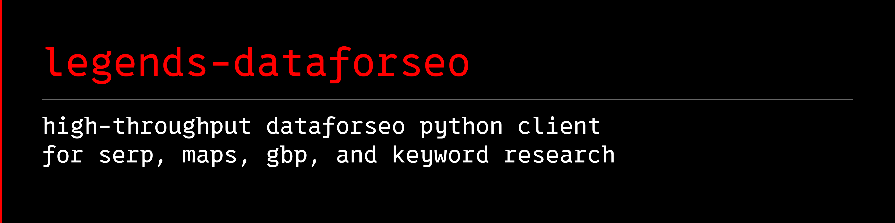
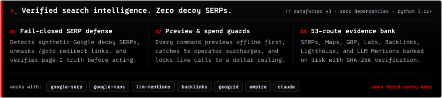
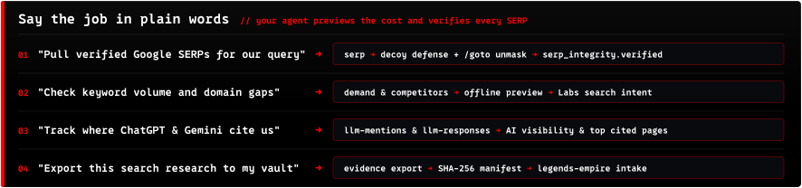
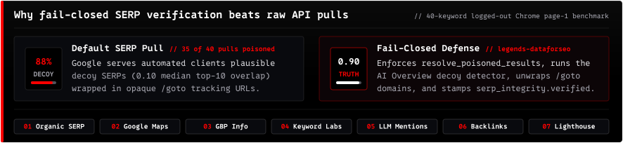
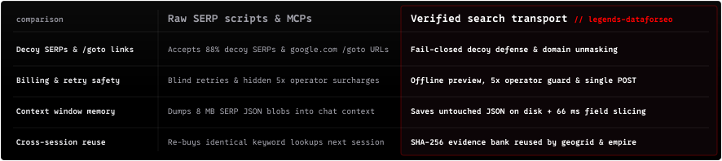

<a id="top"></a>

<p align="center"></p>

# legends-dataforseo: verified Google SERP, Maps, keyword, backlink, and AI visibility intelligence for coding agents

[](https://github.com/avalonreset/legends-dataforseo/releases/latest)
[](https://github.com/avalonreset/legends-dataforseo/actions/workflows/ci.yml)
[](docs/INSTALL.md)
[](LICENSE)

Point a raw Python script or an ambient MCP wrapper at a search API and three things break silently: Google feeds automated requests synthetic decoy SERPs where the top ten barely resembles a real browser, organic URLs arrive wrapped in opaque `google.com/goto` redirect links, and an eight-megabyte JSON response floods your coding agent's context window on the very first turn.

**The human is the controller. The agents do the operating.**

`legends-dataforseo` connects coding agents, CLI workflows, and Python applications to the 53-route DataForSEO API v3 catalog using only the Python 3.11+ standard library. Every command previews its payload and cost offline by default, enforces fail-closed decoy SERP defense and automatic `/goto` domain unmasking on live organic pulls, guards against hidden 5x search-operator billing surcharges, and banks untouched responses on disk with SHA-256 verification.

<p align="center"></p>

```text
Set up legends-dataforseo through cto-legends, run the offline doctor check,
and preview a Google SERP and keyword demand lookup without spending credits.
```

<p align="center"></p>

[Plain english](#search-intelligence-in-plain-english) · [Decoy SERP defense](#the-88-decoy-serp-trap-and-fail-closed-verification) · [53-route catalog](#why-verified-search-transport-beats-raw-scripts-and-ambient-mcps) · [Reference](#reference)

---

## Search intelligence in plain english

You should never have to hand-write JSON task payloads, calculate search-operator billing multipliers, or grep multi-megabyte SERP responses by hand. Describe the search evidence you need in plain english, and [`cto-legends`](https://github.com/avalonreset/cto-legends) routes the request to `legends-dataforseo`.

<p align="center"></p>

Here are four everyday jobs `legends-dataforseo` handles from a single sentence.

**"Pull verified Google SERPs for our query."**

Your agent previews the organic search request first, then executes within your approved dollar ceiling with mandatory decoy SERP protection (`resolve_poisoned_results: true`), automatic Page-1 `/goto` redirect unwrapping, and fail-closed `serp_integrity.verified` stamping. If Google returns an unresolved decoy SERP, the transport raises `UnverifiedSerpError` instead of handing fake rankings to your downstream analysis.

**"Check keyword volume and domain gaps."**

Whether you need monthly search volume and CPC demand (`demand`), SERP competitors (`competitors`), every keyword a domain ranks for (`ranked-keywords`), top ranking pages (`relevant-pages`), or multi-domain keyword intersections (`domain-intersection`), your agent previews the DataForSEO Labs call offline and caches the complete response on disk.

**"Track where ChatGPT and Gemini cite us."**

Across the AI Optimization routes (`llm-mentions`, `llm-mentions-top-domains`, `llm-mentions-top-pages`, `llm-mentions-aggregated`, and `llm-responses` across ChatGPT, Claude, Gemini, and Perplexity), your agent measures which domains and URLs frontier models cite for your target topics and compares AI search visibility against organic Google rankings.

**"Export this search research to my vault."**

Instead of leaving search research trapped inside a chat transcript, `legends-dataforseo evidence` packages raw JSON responses into content-addressed folders bound to a SHA-256 manifest and workspace ID. Sibling modules such as [`legends-empire`](https://github.com/avalonreset/legends-empire), [`legends-geogrid`](https://github.com/avalonreset/legends-geogrid), [`legends-firecrawl`](https://github.com/avalonreset/legends-firecrawl), and [`legends-github`](https://github.com/avalonreset/legends-github) verify and reuse those packages offline without paying for duplicate lookups.

---

## The 88% decoy SERP trap and fail-closed verification

When an automated client queries Google organic search without active anti-poisoning verification, Google frequently returns a **decoy SERP**: ten plausible-looking organic listings that do not match what a human sees in a real browser.

On November 20, 2026, we benchmarked 40 real keywords against logged-out Chrome page 1 as ground truth:

- **Default unprotected SERP pulls:** **35 of 40 queries (88%) returned a decoy SERP**, with a median top-10 overlap of just `0.10` and the true `#1` result matching only `6 of 40` times.
- **With `resolve_poisoned_results` enabled:** Median top-10 overlap jumped to **`0.90`** (`31 of 40` exact `#1` matches, and `0 of 7` decoys across our technical CTO keyword subset).

<p align="center"></p>

Simply turning on a provider flag is not enough, because upstream resolve parameters are **fail-open**: if a resolve pass fails to swap a decoy, the API still returns HTTP 200. `legends-dataforseo` enforces a fail-closed verification pipeline on every organic SERP pull:

1. **Mandatory `resolve_poisoned_results: true` on organic SERPs.** Both `serp()` and raw `api_request()` enforce `resolve_poisoned_results: true` across live and standard-queue organic endpoints (`live/advanced`, `live/regular`, `live/html`, `task_post`), while rejecting URL-encoded `udm=14` / `udm=web` parameters that bypass protection.
2. **The AI Overview (`AIO`) Decoy Detector.** Even when a decoy swaps out the organic list, Google's AI Overview block still cites the real page-1 authorities. Whenever an AI Overview cites at least three domains and fewer than 60% of them appear anywhere in the organic top 20, `assess_decoy_signals()` flags `suspect_decoy` (achieving `1.0` precision and `1.0` recall on default benchmark rows) and triggers bounded retries or raises `UnverifiedSerpError`.
3. **Automatic `/goto` Redirect Unmasking and Platform Resolution.** When Google wraps organic items in `/goto?url=` or `/url?q=` links (`raw_domain: google.com`), `legends-dataforseo` unwraps Page-1 URLs automatically (`depth <= 10`) and extracts the true domain from the breadcrumb host or a closed `WEBSITE_NAME_PLATFORMS` allowlist (so an item whose breadcrumb is `"30+ comments · 2 years ago"` and whose `website_name` is `"Reddit · r/philadelphia"` resolves cleanly to `resolved_domain: reddit.com` and `breadcrumb_path_hint: r/philadelphia`, never guessing domains from random business names).
4. **Google 5x Search-Operator Surcharge Preflight Guard.** Using any of Google's 16 billed search operators (`site:`, `inurl:`, `intitle:`, `filetype:`, `cache:`, `allin*`, etc.) multiplies provider task billing **5x**. The preflight estimator detects all 16 operators (including quoted, parenthesized, or URL-encoded `q=` syntax) and floors the cost estimate before a single byte leaves your machine.

---

## Why verified search transport beats raw scripts and ambient MCPs

Loading an always-on search MCP server injects dozens of tool schemas into Turn 0 of every session and streams raw multi-megabyte JSON payloads straight into your prompt context. Writing ad-hoc Python scripts is even riskier: a naive retry loop around a slow POST request can drain your DataForSEO balance in minutes.

<p align="center"></p>

`legends-dataforseo` covers **53 registered DataForSEO v3 routes** across eight families with zero third-party Python dependencies:

| Family | Included CLI & Python surfaces | What you get |
| --- | --- | --- |
| **Organic & AI SERP** | `serp()` / `legends-dataforseo serp`, `serp-task-post`, `serp-task-get`, `ai-mode`, `serp-ai-summary`, `serp-screenshot` | Google organic SERPs with mandatory decoy defense (`serp_integrity.verified`), automatic `/goto` domain unmasking, 5x operator cost guards, Google AI Mode, AI summaries, and SERP screenshots |
| **Google Maps & Local** | `maps()` / `legends-dataforseo maps`, `local-finder`, standard queue tasks | Coordinate-locked Google Maps rank packs, Local Finder results, and bounded `wait` / `wait_task()` GET polling for [`legends-geogrid`](https://github.com/avalonreset/legends-geogrid) circular-lattice studies |
| **Business Profiles** | `business()` / `legends-dataforseo business`, `business-task-post`, `business-task-get` | Google Business Profile (`my_business_info`) lookups and queue refreshes by exact `cid`, `place_id`, or keyword |
| **DataForSEO Labs** | `demand()`, `competitors()`, `ranked_keywords()`, `relevant_pages()`, `keywords-for-site`, `domain-intersection`, `historical-serp`, `subdomains` | Monthly search volume, CPC, keyword difficulty, SERP competitors, domain keyword portfolios, multi-domain gap intersections, and historical rank snapshots |
| **AI Optimization (LLM)** | `llm-mentions`, `llm-mentions-top-domains`, `llm-mentions-top-pages`, `llm-mentions-aggregated`, `llm-responses-chatgpt`, `llm-responses-claude`, `llm-responses-gemini`, `llm-responses-perplexity`, `ai-keyword-volume` | Live LLM mention tracking, top-cited domains and URLs, cross-aggregated AI visibility metrics, and live responses across ChatGPT, Claude, Gemini, and Perplexity |
| **Backlinks** | `referring-domains`, `anchors`, `backlinks-list` | Referring domain inventories, anchor text distributions, and individual backlink authority and spam verification |
| **On-Page & Lighthouse** | `content-parsing`, `lighthouse` | Structured page content extraction and Google Lighthouse technical performance and accessibility audits |
| **Docs & Evidence Bank** | `routes`, `route`, `estimate`, `docs search`, `docs read`, `view`, `evidence` | Offline route discovery, certifi-backed official DataForSEO docs search/cache, 66 ms dotted-path JSON slicing, and SHA-256 research evidence packaging for [`legends-empire`](https://github.com/avalonreset/legends-empire) and [`legends-firecrawl`](https://github.com/avalonreset/legends-firecrawl) |

---

## Optional MCP Plug-In: Legends Gambit (Open Beta)

Want verified search results and keyword demand without opening a vendor account?

This module stays 100% local, free, and MIT open source on your own accounts. That does not change.

If you want pay-per-run audits without vendor accounts or subscriptions, [Legends Gambit](https://cto-legends.com/gambit) (**Legends Gambit: SEO MCP Server & Market Intelligence (by CTO Legends)**, open beta) is one optional MCP intelligence plug-in beside it:

- One Streamable HTTP endpoint (`https://gambit.cto-legends.com/mcp`) and one Bearer API key. Works in Claude Code, Cursor, Antigravity, Claude Desktop, and OpenCode (open read-only `initialize` and `tools/list` discovery)
- Non-expiring prepaid wallet ($10 starter top-up), zero vendor accounts, zero subscriptions
- From $0.05/run: verified SERP ($0.05), keyword demand ($0.05 for up to 25 keywords), competitor teardown ($0.15), market dossier ($0.50), and circular hexagonal Google Maps rank grids ($0.04/hex point: $0.76 for 19 pts, $1.48 for 37 pts, up to $6.76 for 169 pts across 0.5-50 km radius, with a 19-page vector hex PDF)
- Anything above your per-call limit (default $0.25) is quoted first. Failed runs and 24-hour same-wallet repeats cost $0.00, and verified cache hits are at least 60% off

```bash
claude mcp add --transport http legends-gambit https://gambit.cto-legends.com/mcp --header "Authorization: Bearer YOUR_API_KEY"
```

Create an API key at [gambit.cto-legends.com/wallet](https://gambit.cto-legends.com/wallet) or read the docs at [cto-legends.com/gambit](https://cto-legends.com/gambit). Prefer to run 100% locally? Keep reading. Everything below needs nothing from us.

---

## Reference

Everything you need to run `legends-dataforseo` through your coding agent is in the guide above. Open these drawers for the CLI reference, Python API examples, credential configuration, and documentation links.

<details>
<summary><strong>CLI reference and agent setup</strong></summary>

<br>

### Agent setup (via `cto-legends`)

Part of the [`cto-legends`](https://github.com/avalonreset/cto-legends) ecosystem. `cto-legends` is the only registered skill; this repository vendors a pinned copy at [`skills/cto-legends/SKILL.md`](skills/cto-legends/SKILL.md). Install with `cto-legends install legends-dataforseo` and let the router resolve [`docs/AGENT-RECIPE.md`](docs/AGENT-RECIPE.md) on demand. Do not register this module as a standalone skill folder.

```sh
python -m pip install cto-legends
cto-legends install legends-dataforseo
cto-legends install legends-dataforseo --apply
cto-legends handoff legends-dataforseo
```

For a standalone virtual-environment install from a GitHub release wheel or checkout ([`docs/INSTALL.md`](docs/INSTALL.md)):

```sh
python -m pip install -e .
legends-dataforseo --version
legends-dataforseo doctor
```

Every named command previews its exact v3 path, JSON request body, and cost parameters offline by default without opening a network socket:

```sh
legends-dataforseo serp "technical SEO" --location-code 2840
```

```json
{
  "preview": true,
  "path": "/serp/google/organic/live/advanced",
  "method": "POST",
  "body": [{"language_code": "en", "keyword": "technical SEO", "depth": 10, "location_code": 2840,
            "resolve_poisoned_results": true, "resolve_goto_urls": true}],
  "estimated_cost_usd": null,
  "max_cost_usd": null
}
```

Explore all 53 routes, calculate preflight cost estimates (including 5x search-operator detection), search official provider documentation, or slice saved responses in milliseconds:

```sh
legends-dataforseo routes
legends-dataforseo estimate maps --tasks 9 --depth 100
legends-dataforseo demand "technical SEO" "local SEO"
legends-dataforseo docs search "google maps task_post" --limit 3
legends-dataforseo docs read serp/google/maps/task_post
legends-dataforseo view results.json --select tasks.0.result.0.items --limit 3
legends-dataforseo view results.json --summary
```

Paid CLI calls require three explicit flags (`--execute`, `--estimated-cost-usd`, and `--max-cost-usd`) and abort before opening a socket if the preflight floor exceeds your ceiling. Existing `--output` files are refused before HTTP so saved research is never overwritten. See [`docs/CLI.md`](docs/CLI.md) and [`docs/FIRST-USE.md`](docs/FIRST-USE.md).

</details>

<details>
<summary><strong>Python API, credentials, and architecture</strong></summary>

<br>

### Credentials

Set `DATAFORSEO_LOGIN` (or `DATAFORSEO_USERNAME`) and `DATAFORSEO_PASSWORD` in your shell or secret manager. The loader reads a complete process environment pair first, then the Windows user environment, and never mixes scopes or accepts secrets on command-line arguments ([`docs/INSTALL.md#credentials`](docs/INSTALL.md#credentials)). Run `legends-dataforseo doctor --live` to verify authentication with a zero-charge check.

### Python API

```python
from legends_dataforseo import api_request, serp

# Verified organic SERP pull with mandatory decoy defense & /goto unmasking:
organic = serp(
    "technical SEO consultant",
    location_code=2840,
    confirm=True,
    consumer="my-app",
    estimated_cost_usd=0.005,
    max_cost_usd=0.01,
)
print(organic["legends_serp"]["verified"], organic["legends_serp"]["verified_basis"])

# Standard-queue Google Maps task submission:
response = api_request(
    "/serp/google/maps/task_post",
    [{"keyword": "coffee", "location_coordinate": "40.7128,-74.0060,15z",
      "language_code": "en", "depth": 100, "priority": 1}],
    confirm=True,
    consumer="my-app",
    estimated_cost_usd=0.01,
    max_cost_usd=0.01,
)
for task in response.get("tasks") or []:
    print(task.get("id"), task.get("status_code"))
```

Paid submissions are never placed inside automatic retry loops or switched between accounts. Retrieve saved queue tasks with `api_request("/serp/google/maps/task_get/advanced/" + task_id)` or `wait_task()`. Status `40102` indicates an empty search result for that coordinate or query, not a transport error. See [`docs/API.md`](docs/API.md).

### Architecture & documentation map

```text
Caller (Coding Agent, CLI, or Python App)
  -> 53-route registry, 5x operator cost guard & offline preview
  -> Single-request HTTPS v3 transport (no blind POST retries)
  -> Decoy SERP detector (resolve_poisoned_results + AIO backstop) & /goto domain unmasker
  -> Untouched JSON envelope on disk + SHA-256 evidence bank (`legends-dataforseo evidence`)
```

- **Guides:** [`docs/AGENT-RECIPE.md`](docs/AGENT-RECIPE.md) · [`docs/API.md`](docs/API.md) · [`docs/CLI.md`](docs/CLI.md) · [`docs/INSTALL.md`](docs/INSTALL.md) · [`docs/FIRST-USE.md`](docs/FIRST-USE.md) · [`docs/WORKFLOWS.md`](docs/WORKFLOWS.md) · [`docs/DISCOVERY.md`](docs/DISCOVERY.md) · [`docs/RESEARCH-MEMORY.md`](docs/RESEARCH-MEMORY.md) · [`docs/INTEGRATIONS.md`](docs/INTEGRATIONS.md) · [`docs/VERIFICATION.md`](docs/VERIFICATION.md) · [`docs/UPSTREAM.md`](docs/UPSTREAM.md) · [`docs/SEARCH-STRATEGY.md`](docs/SEARCH-STRATEGY.md) · [`examples/offline.py`](examples/offline.py)

</details>

<details>
<summary><strong>FAQ, support, and attribution</strong></summary>

<br>

- **Does `legends-dataforseo` make paid API calls by default?**
  No. Named CLI commands (`serp`, `maps`, `business`, `demand`, `competitors`, `ranked-keywords`, `relevant-pages`) preview the request payload offline by default. Paid execution requires `--execute`, `--estimated-cost-usd`, and `--max-cost-usd` on the CLI, or `confirm=True` in Python.
- **What happens if Google returns a decoy SERP on a live organic pull?**
  Every organic pull enforces `resolve_poisoned_results: true`, checks the response against the `suspect_decoy` detector (including the AI Overview domain-overlap backstop), and raises `UnverifiedSerpError` (CLI exit code `2`) if the SERP remains unverified, preventing poisoned rankings from entering your reports or [`legends-firecrawl`](https://github.com/avalonreset/legends-firecrawl) `scrape-serp` pipelines.
- **Do I need DataForSEO credentials to explore routes or run tests?**
  No. Route discovery (`routes`, `route`, `estimate`), offline previews, and the full `pytest` test suite run locally without credentials across Windows, Linux, and macOS.
- **Support & security:** [Report a bug or request a feature](https://github.com/avalonreset/legends-dataforseo/issues/new/choose) · [`CONTRIBUTING.md`](CONTRIBUTING.md) · [`SUPPORT.md`](SUPPORT.md) · [`CODE_OF_CONDUCT.md`](CODE_OF_CONDUCT.md) · [`SECURITY.md`](SECURITY.md)
- **License & provenance:** Released under the [MIT License](LICENSE). See [`NOTICE`](NOTICE), [`THIRD_PARTY_NOTICES.md`](THIRD_PARTY_NOTICES.md), [`CITATION.cff`](CITATION.cff), and [`docs/PROVENANCE.md`](docs/PROVENANCE.md). Independent open-source software, not an official DataForSEO SDK.

</details>

---

## Start here

Paste the [agent handoff block](#top) at the top of this page into your coding agent, preview any of the 53 DataForSEO v3 routes offline, and run verified search intelligence with zero decoy SERPs and zero context bloat.

<p align="center"><a href="https://github.com/stars/avalonreset/lists/cto-legends"></a></p>

Running a company or technical SEO operation and want verified search intelligence, AI citation tracking, and local evidence banking wired directly into your stack? Message Avalon Reset at [cto-legends.com/dm](https://cto-legends.com/dm). The desk is async, so the conversation starts the moment you write and nobody forces you onto a sales call.

<p align="center"><a href="https://cto-legends.com/dm"></a></p>

---

**Specification & benchmarks on cto-legends.com:**
- **Module specification & architecture matrix:** [cto-legends.com/modules/legends-dataforseo](https://cto-legends.com/modules/legends-dataforseo)
- **Related engineering dispatches:** [How to Choose MCP vs CLI Tools Without Context Bloat](https://cto-legends.com/blog?post=mcp-vs-cli) · [Routing Cursor vs Claude Code by Blast Radius and Cost](https://cto-legends.com/blog?post=cursor-vs-claude-code) · [AI Agent Governance: Markdown Knowledge Base & Vault Architecture](https://cto-legends.com/blog?post=ai-agent-governance)
- **Ecosystem hub:** [cto-legends.com/home](https://cto-legends.com/home)
